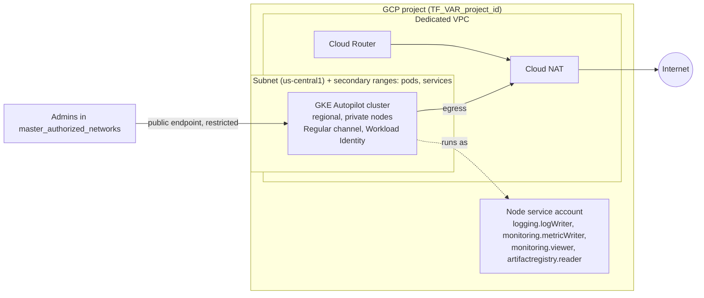

# GKE Autopilot on GCP with OpenTofu

OpenTofu (not Terraform) project that creates a **regional (multi-zone) private GKE Autopilot cluster** in `us-central1`.
No credentials or project IDs live in this repo; everything is supplied through `TF_VAR_*` environment variables.

## Architecture



Layout: root module (`main.tf`, `variables.tf`, `outputs.tf`, `versions.tf`) calling `modules/gke-autopilot`.

## Inputs

| Variable | Env var | Default |
|---|---|---|
| `project_id` | `TF_VAR_project_id` | required |
| `region` | `TF_VAR_region` | `us-central1` |
| `cluster_name` | `TF_VAR_cluster_name` | `gke-autopilot` |
| `master_authorized_networks` | `TF_VAR_master_authorized_networks` | `[]` — **must be set** to reach the API; empty means no one can |
| `deletion_protection` | `TF_VAR_deletion_protection` | `true` |

Example: `export TF_VAR_master_authorized_networks='[{"cidr_block":"203.0.113.0/24","display_name":"office"}]'`

Outputs: `cluster_name`, `cluster_endpoint` (sensitive), `cluster_location`.

## Run manually

Only validation was executed (no GCP credentials; `apply` was never run):

```sh
export TF_VAR_project_id=example   # placeholder
tofu fmt -check -recursive         # no output, exit 0
tofu init -backend=false           # installed hashicorp/google v6.50.0, wrote .terraform.lock.hcl
tofu validate                      # Success! The configuration is valid.
tflint --init && tflint --recursive --minimum-failure-severity=warning   # exit 0, no findings
trivy config --severity HIGH,CRITICAL --exit-code 1 .                    # 0 misconfigurations
betterleaks dir .                  # no leaks found
```

To deploy (not run here): `gcloud auth application-default login`, set `TF_VAR_project_id` and `TF_VAR_master_authorized_networks`, then `tofu plan` / `tofu apply`.

## CI

`.github/workflows/ci.yml` — keyless (no secrets/cloud creds), runs on `pull_request` and `push` to `main`, `permissions: contents: read`, concurrency with `cancel-in-progress`, all actions pinned by full commit SHA. OpenTofu version is pinned in `.opentofu-version` (1.8.8). Dependabot (`.github/dependabot.yml`) updates GitHub Actions and the Terraform/OpenTofu providers weekly.

| Job | What it does |
|---|---|
| `fmt` | `tofu fmt -check -recursive` |
| `validate` | `tofu init -backend=false` + `tofu validate` for the root and each `modules/*` |
| `lint` | `tflint` with the `terraform` (recommended) and `google` rulesets (`.tflint.hcl`, ruleset pinned) |
| `security` | `trivy config` (trivy-action) failing on HIGH/CRITICAL; exceptions go in `.trivyignore` (currently empty) |
| `secrets` | `betterleaks dir .` (pinned version, built with `go install`) |

`plan-smoke` is intentionally **skipped**: `tofu plan` with the Google provider needs credentials and live API access, which this keyless pipeline does not have.

## Production checklist

- [ ] Remote state backend (GCS bucket with versioning + CMEK) and state locking
- [ ] Set `master_authorized_networks` to specific CIDRs (never `0.0.0.0/0`); consider `enable_private_endpoint` + bastion/IAP
- [ ] Keep `deletion_protection = true`
- [ ] Deploy via CI with Workload Identity Federation (no long-lived keys)
- [ ] Review CIDR ranges for non-overlap with peered networks
- [ ] Enable required APIs (container, compute, iam) and org policies
- [ ] Configure budgets/alerts, logging sinks, and monitoring
- [ ] Binary Authorization, Cloud Armor/ingress policy, NetworkPolicies as needed
- [ ] Review and merge Dependabot updates; commit `.terraform.lock.hcl`
